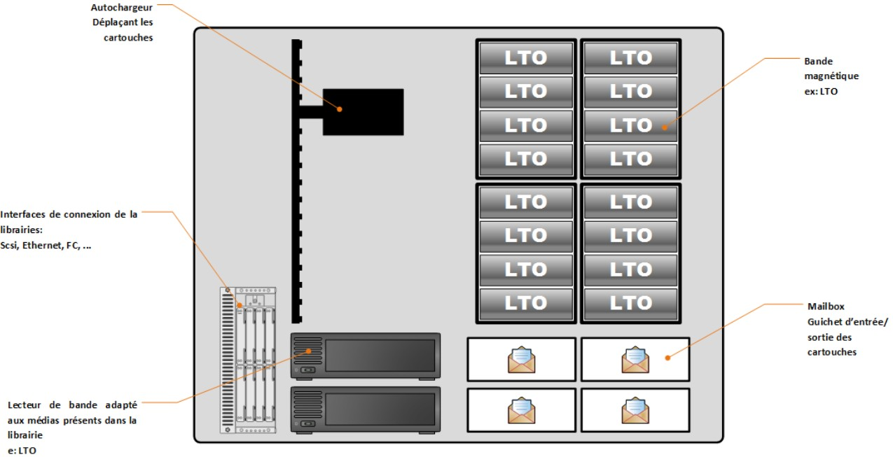
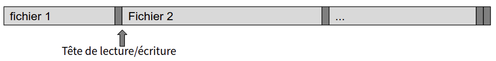
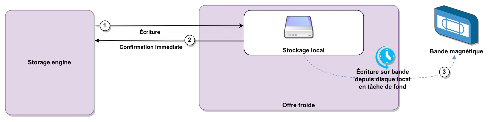
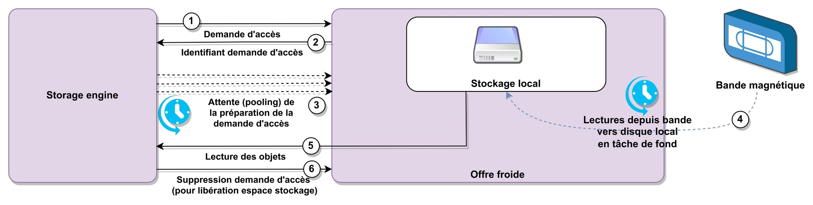
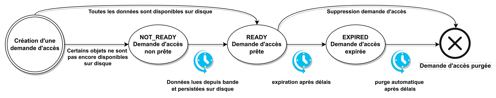
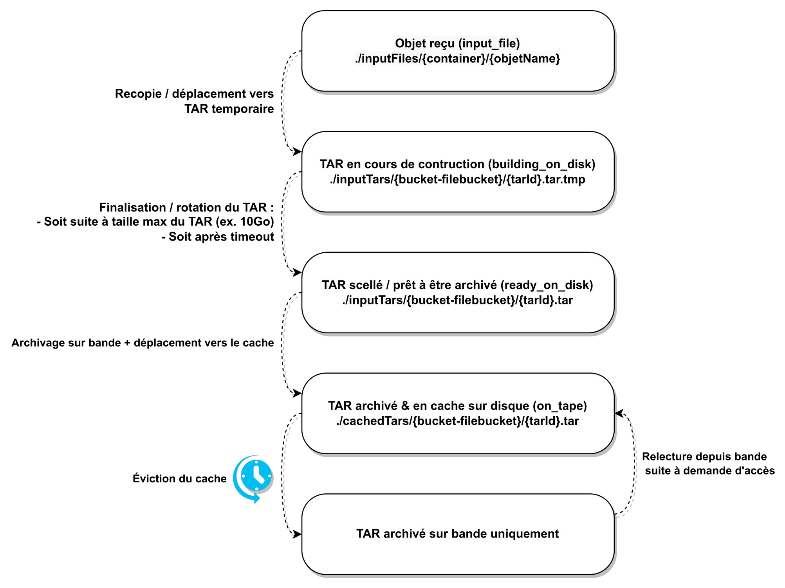
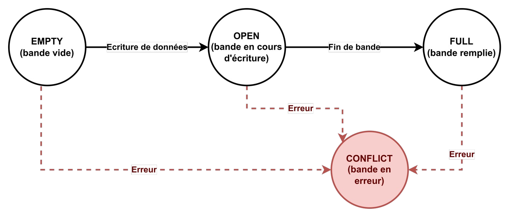
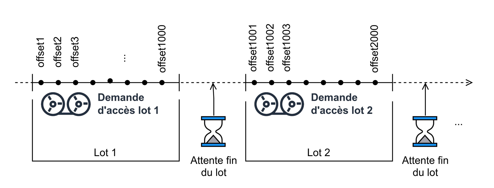
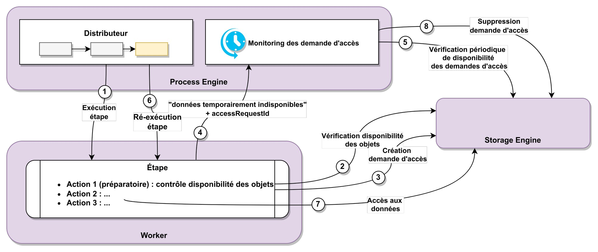
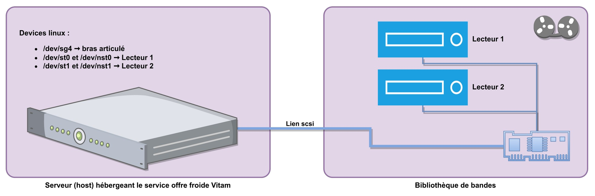

Archivage sur Offre Froide
==========================

Résumé
------

Jusqu’à présent, pour la gestion, la conservation, la préservation et la consultation des archives numériques, les acteurs du secteur public étatique ont utilisé des techniques d’archivage classiques, adaptées aux volumes limités dont la prise en charge leur était proposée. Cette situation évolue désormais rapidement et les acteurs du secteur public étatique doivent se mettre en capacité de traiter les volumes croissants d’archives numériques qui doivent être archivés, grâce à un saut technologique.

### Documents de référence

|**Document**|**Date de la version**|**Remarques**|
|:---------------:|:-----:|:-----:|
|[Vitam – Documentation d’installation](https://www.programmevitam.fr/ressources/DocCourante/html/installation)|||
|[Vitam – Documentation d’exploitation](https://www.programmevitam.fr/ressources/DocCourante/html/exploitation)|||
|[Vitam – Gestion des habilitations](./gestion_habilitations.md)|||

### Présentation du document

Le document décrit l’archivage de données dans la solution logicielle Vitam sur des bandes magnétiques.

Il s’articule autour des axes suivants :

- généralités sur le stockage sur bande magnétiques ;
- fonctionnement de l’offre froide Vitam ;
- intégration technique avec une bande magnétique ;
- limitations et évolutions futures de la solution.

Le présent document décrit les fonctionnalités qui sont offertes par la solution logicielle Vitam au terme de la version 10.0 (automne 2026). Il a vocation à être amendé, complété et enrichi au fur et à mesure de la réalisation de la solution logicielle Vitam et des retours et commentaires formulés par les ministères porteurs et les partenaires du programme.

Généralités
-----------

En plus des offres FileSystem, S3 et Swift, Vitam dispose d'une offre de stockage sur bandes magnétiques appelée **Offre Froide**.

Les données sont écrites sur un support physique amovible de type bande magnétique, similaire au principe des cassettes “VHS”. Il s’agit d’une technologie principalement utilisée pour les backups de données volumineux dont l’accès est occasionnel.

Les données sont écrites via des lecteurs dédiés sur des bandes à très forte densité. Permettant ainsi de stocker de très gros volumes de données et à faible coût.

A titre d’exemple, une seule bande de type LTO-9 (2020) peut stocker 18 To avec débit de 708 Mo/s (voire 45 To si compression des données), avec une très grande longévité (15-30 années).

### Bibliothèque de bandes

Une **bibliothèque de bandes (Tape Library)** consiste en :

- Un ensemble de **bandes magnétiques** (aussi appelées **tapes** ou **cartridges**)
- Un ou plusieurs **lecteurs** (**drives**)
- Des **emplacements de stockage** de bandes (**slots**) où sont entreposées les bandes
- Un **robot** / **bras articulé** (**changer**, **auto-loader**) permettant de charger les bandes depuis un slot vers un lecteur, et inversement, de décharger une bande d’un lecteur vers un slot

Certains modèles de bibliothèques de bandes physique peuvent être partagée en plusieurs bibliothèques de bandes logiques, chacune disposant de ses lecteurs & bandes dédiées à une application donnée. Chaque application ne “voit” que les drives & slots qui lui sont affectés.

Une bibliothèque de bandes virtuelle (Virtual Tape Library, VTL) est un émulateur logiciel d’une bibliothèque de bandes physique. Il peut être utilisé pour tester une installation d’offre froide Vitam sans accès physique à une bibliothèque de bande physique.

### Quand utiliser un stockage sur bandes magnétiques ?

Les offres chaudes (FileSystem, S3, Swift) correspondent à la majorité des cas d’usage de Vitam. Elles permettent de stocker un gros volume de données avec accès en écriture et lecture immédiat, et pour un coût de stockage correct.
Le stockage sur bande est quant-à lui plus adapté à l’archivage de binaires très volumineux, et pour lesquels l’accès en lecture est très rare. Il s’agit d’un mode de stockage principalement adapté pour l’archivage à bas coûts de très gros volumes de données rarement relues.

C’est également une contre-mesure efficace contre les attaques de type « ransomware », les attaquants ayant des difficultés à accéder aux données réparties sur de nombreuses bandes.

**Avantages de l’offre froide**

- Coût de stockage assez compétitif pour les très grosses volumétries (densité de stockage, consommation électrique, refroidissement…)
- Bonnes performances d’écriture / lecture pour les données séquentielles
- Possibilité de gérer de très gros volumes (en Po) sur des milliers de bandes
- Durabilité des bandes (15-30 ans contre 5 ans pour les HDD/SSD), avec 20000 cycles de chargements/déchargements.
- Possibilité de ségrégation physique des données sur bandes différentes (séparer les données selon leur tenants dans des bandes distinctes physiquement)
- Résilience aux attaques de type ransomware (chiffrer ou altérer les données archivées nécessite une réécriture complète des bandes)
- Possibilité de blocage physique des réécritures (WORM), de compression et de chiffrement natifs des données
- Possibilité d’isolation physique des bandes (export physique de la bibliothèque de bandes, et stockage dans cages de faraday)
- Une fois les données inscrites sur les bandes, le stockage est neutre écologiquement : il ne nécessite pas d’électricité, ni de climatisation

**Inconvénients de l’offre froide**

- L’accès aux données est lent et asynchrone ; les opérations sur bandes (chargement, déchargement, repositionnement, lecture, écriture…) peuvent prendre de quelques secondes à plusieurs minutes.
- Présence de “moving parts” ; un grand nombre d’opérations d’insertion / re-positionnement / re-bobinage / éjections des bandes peut altérer la durée de vie des bandes & drives
- Écriture en append-only, pas de “delete”
- Logique d’orchestration compliquée
- Nécessite un catalogue externe (base mongo-offer) pour indexer les objets et leur informations
- Nécessite une infrastructure spécifique (hardware, hébergement…), coûteuse à installer et réquiérant des compétences particulière pour l’exploiter

### Fonctionnement du stockage sur bandes magnétiques

Les données sont écrites en séquentiel dans la bande :

La bibliothèque est commandée via un ensemble de primitives simples :

- Charger une bande depuis une slot vers un lecteur vide
- Avancer ou reculer la bande de N enregistrements
- Lire un fichier depuis la position actuelle
- Ecrire un fichier à la position actuelle
- Rembobiner la bande
- Ejecter une bande depuis lecteur
- Décharger une bande depuis une slot vers un lecteur vide

#### Écriture sur une bande

Afin d’écrire des données sur une bande magnétique, la bande cible est chargée depuis un emplacement de stockage vers un lecteur via le bras articulé. Les données sont écrites en fin de la bande (après avancement de la bande / repositionnement préalable de la tête de lecture après le dernier enregistrement).

Si un lecteur contient déjà une autre bande, cette dernière doit être rembobinée, puis déchargée du lecteur avant d’être rangée dans un emplacement de stockage vide, avant que la nouvelle bande puisse être chargée.

#### Lecture depuis une bande

Similairement à l’écriture, la lecture depuis une bande magnétique nécessite que la bande à lire soit préalablement chargée, et que la tête de lecture soit positionnée juste avant l’enregistrement à lire.

#### Suppression

La suppression d’un fichier dans une bande est impossible car il nécessite soit un effacement complet de la bande (erase) ou une réécriture par dessus les données existantes, ce qui rend toutes les données suivantes inaccessibles.

La suppression des données est uniquement une suppression “logique” ; les données sont toujours présentes sur la bande, mais ne sont plus indexées.

De même, l’écriture d’une mise à jour d’un objet génère 2 écritures, dont seule la dernière est indexée.

Fonctionnement de l’offre froide Vitam
--------------------------------------

### L’archivage dans des archives TAR

La technologie de stockage des bandes magnétiques n’est pas adaptée à l’écriture et la lecture d’un grand nombre d’objets. En effet, un grand nombre d’opérations sur bandes (chargement, déchargement, repositionnement, écriture…) réduisent considérablement la durée de vie des bandes et la durabilité des lecteurs et du robot, en plus de causer des latences conséquentes lors des accès I/O.

Dans l’offre froide Vitam, les objets ne sont pas écrits individuellement, mais sont plutôt regroupés dans des archives TAR avant d’être archivés.

En effet, le format TAR (de l'anglais Tape ARchiver), est le format de facto pour l’archivage sur support magnétique. En plus d’être un format simple et bien supporté, les archives TAR offrent l’avantage de permettre un accès direct (random access) à une entrée de l’archive, directement par son offset.

À noter qu’aucune compression n’est opérée sur les archives TAR. Les bibliothèques de bandes supportent souvent déjà une compression des données native.

### Disque local de l'offre froide

Dans le cas d'une offre chaude (FileSystem, S3 ou Swift), la lecture et l'écriture des données sont immédiates vers et depuis le support de stockage cible. Ces offres sont dites **synchrones**.

A contrario, l'écriture et la lecture sur une bande magnétique nécessitent un délai de traitement beaucoup plus conséquent pour la manipulation du bras articulé, du lecteur et de la bande (de quelques secondes pour une opération simple, à quelques heures, voir jours, pour traiter un grand lot d'opérations). L'offre froide est dite **asynchrone**.

Pour mitiger ces contraintes, l’offre froide de Vitam utilise un stockage temporaire sur FileSystem local des données à lire / écrire depuis / vers une bande.

Ainsi, lorsqu'une demande d'écriture est transmise à l’offre froide de Vitam, l'objet est stocké temporairement sur le disque, et l’appelant reçoit une confirmation de prise en charge. Ensuite, un traitement de background s'assure de l’écriture effective des données sur une bande.

Ceci permet à l’offre froide de Vitam de disposer d’une API d’écriture synchrone, même si l’archivage effectif sur bande est asynchrone.

### Les demandes d’accès

La lecture, quant-à-elle, nécessite la présence des données sur disque local. Pour s’assurer de la disponibilité des données, l’appelant doit préalablement faire une **demande d’accès** (access request).

A réception d’une demande d’accès, l’offre froide vérifie la disponibilité des données demandées sur le disque local. Dans le cas contraire, elle planifie leur lecture depuis bande pour les rapatrier sur disque.

Chaque demande d’accès possède un identifiant unique (accessRequestId) permettant la vérification régulière de son état (polling).

Une fois la demande d'accès est prête, i.e. tous les objets nécessaires sont présents sur disque local, la lecture des objets peut être réalisée.

Enfin, la demande d’accès est supprimée pour libérer les ressources depuis l’espace de stockage local.

A la création d’une demande d’accès, si les objets sous-jacents sont déjà disponibles, la demande d’accès est au statut `READY` (prête). Dans le cas contraire, est au statut `NOT_READY` (non prête).

L’accès aux données sous-jacentes est garanti jusqu’à suppression explicite de la demande d’accès par l’appelant (recommandé), ou expiration automatique au bout d’un délai (configurable).

Une demande d’accès expirée sera purgée automatiquement au bout d’un délai de purge (configurable).

### Buckets & file buckets

L'offre froide de Vitam permet d'isoler physiquement les données écrites sur les bandes par tenant ou ensemble de tenants via le paramétrage de **buckets**.

Un exemple de configuration serait :

- bucket “test” : tenant 0
- bucket “admin” : tenant 1
- bucket “production” : tenants 2, 3 et 4
- bucket “critical” : tenant 5

Une bande ne peut contenir que les données d'un seul bucket. Ainsi, les données des tenants 2 à 4 peuvent être archivées dans une même bande, mais ne peuvent être archivées sur le même support physique que des données des tenants 0, 1 ou 5.

**NB.** Tous les tenants doivent être affectés à un et un seul bucket.

**NB.** L’affectation d’un tenant à un bucket est définitive. i.e. Il est impossible de modifier le bucket auquel un tenant a été déjà affecté car les données ont déjà été écrites sur bandes. Il est possible cependant, lors de l’ajout d’un tout nouveau tenant à Vitam, d’affecter ce nouveau tenant à un bucket existant.

À noter également qu’au sein d’un même bucket, Vitam regroupe les objets par type de données dans des catégories appelées **file-buckets** :

- **metadata** (unités archivistiques, groupes d’objets techniques, ainsi que leur journaux de cycles de vie)
- **objects** (objets binaires)
- **default** (données système. i.e. tous les autres conteneurs restants)

Le regroupement des objets par file-buckets permet :

- Une colocalisation des données de même nature (les objets de même nature sont souvent lus en même moment) ;
- et de permettre une politique d’expiration selon le type de données.

**NB.** La liste des file-buckets et leur paramétrage sont prédéfinis et non modifiables.

### Fonctionnement du cache

L’offre froide Vitam utilise également le disque local comme cache pour persister localement les archives TAR (`/vitam/data/offer/cachedTars/`).

Ainsi, dès qu’un fichier TAR est archivé, il est déplacé dans le cache pour un éventuel accès futur depuis disque local. De même, si un fichier TAR est relu depuis une bande suite à une demande d’accès, l’archive récupérée est également entreposée dans le cache.

Afin de ne pas saturer l'espace de stockage, les anciens TAR (les moins récemment lus) sont périodiquement évincés du système (politique d’éviction LRU, Least Recently Used).

Le cache est configuré avec 3 niveaux de seuils de capacité :

- Niveau maximal (Ex. 10 To pour un env de production)
- Niveau critique à partir duquel le processus l’éviction des TAR est déclenché (Ex. 8 To pour un env de production)
- Niveau confortable, en dessous duquel le processus d'éviction des TAR est arrêté (Ex. 6 To pour un env de production)

Vitam s'assure que lorsque le seuil critique est atteint, les TAR les moins récemment lus sont purgés jusqu'à disposer de suffisamment d'espace disque (en dessous du niveau confortable). Vitam s'assure également que la capacité maximale du cache n'est en aucun cas dépassée.

À noter également que les TAR référencés par des demandes d'accès actives ne sont pas purgeables du cache (on ne supprime pas des TAR pour lesquels un processus Vitam ou un utilisateur souhaite avoir accès).

De même, seuls les TAR qui contiennent des binaires sont purgeables du cache (file-bucket *objects*).

Les TAR qui abritent des métadonnées et leurs journaux de cycle de vie (file-bucket *metadata*), ou des données système (file-bucket *default*) ne sont pas supprimables du cache.

**NB.** Ce choix de design de rendre les file-buckets *metadata* et *default* non expirables permet en particulier la reconstruction depuis une offre froide, ou même de permettre un déploiement Vitam basé uniquement sur des offres froides (sans offres chaudes).

### Cycle de vie des objets dans l’offre froide de Vitam

Lors d’une écriture unitaire d’un objet ou en bulk d’un lot d’objets, les objets reçus par l’offre froide sont initialement écrits à plat dans un dossier dédié du FileSystem local : `/vitam/data/offer/inputFiles/{container}/*`

Ensuite, un processus en background recopie ces objets vers une archive TAR en cours de construction, selon le bucket / file-bucket cibles :

`/vitam/data/offer/inputTars/{bucket-filebucket}/`**`*.tar.tmp`**

**NB.** Les objets très volumineux sont découpés en segments de 1 Go (configurable), et peuvent du coup donc s'étaler sur plusieurs archives TAR.

Lorsqu’un TAR en cours de construction atteint une taille maximale configurée (10 Go par défaut), ou bien, après un délais maximum configuré (6h par exemple), le TAR est finalisé /scellé (renommé en `/vitam/data/offer/inputTars/{bucket-filebucket}/`**`*.tar`**).

Une fois un TAR scellé, il est planifié pour être archivé sur bande.

Une fois le TAR est écrit sur bande, il est déplacé dans le cache disque, où il sera persisté jusqu’à éviction éventuelle du cache : `/vitam/data/offer/cachedTars/{bucket-filebucket}/`**`*.tar`**

Lors de la lecture d’un objet depuis l’offre froide Vitam, les objets sont lus directement depuis disque (qu’ils soient encore persistés à plat dans inputFiles, dans un TAR en cours de construction, dans à TAR scellé et non encore archivé, ou dans un TAR archivé et en cache).

L’accès aux objets est pré-conditionné par la création préalable d’une demande d’accès pour s’assurer de leur présence sur disque local.

### L’identification des bandes

Chaque bande possède un code à barres. Vitam utilise ce code à barre pour identifier les bandes de manière unique.

De plus, un fichier appelé **label** est écrit par Vitam avant tout autre fichier à archiver. Le label est un fichier json spécial qui persiste un ensemble d’informations d’identification de la bande (dont le code à barres).

Vitam procède à une vérification du label à chaque chargement de bande dans un lecteur. Ceci permet de s’assurer que la bande chargée est bien celle attendue (label conforme au code à barre de la bande), et qu’à priori, la bande n’a pas été altérée par un tiers.

### Cycle de vies des bandes

Au démarrage de l'offre froide, Vitam scanne la liste des bandes du système et leur emplacement (i.e. telle bande identifiée par tel code à barres, est présente dans tel lecteur ou slot).

Vitam ajoute automatiquement les nouvelles bandes dans son catalogue en base mongo-offer. Une nouvelle bande est supposée être vide (statut `EMPTY` en base).

À la première écriture sur une bande vide, Vitam vérifier qu'aucun enregistrement n'y est déjà présent :

- Si un enregistrement est trouvé (la bande contient déjà des données), une erreur est remontée et la bande est considérée comme inutilisable (statut `CONFLICT` en base). Ceci permet d’éviter d’écraser une bande.
- Sinon, un premier fichier label est écrit, suivi des données à archiver. Le statut de la bande est alors modifié en `OPEN` (en cours d'écriture).

Les données sont écrites dans la bande jusqu’à ce que cette dernière soit remplie.

Si une tentative d’écriture ou de lecture sur une bande échoue, la bande est considérée comme inutilisable (statut `CONFLICT` en base).

**NB.** Il est à noter qu'il est possible de désactiver le contrôle d’absence de données dans une bande vide dans le cas d'un environnement de développement ou de recette. Ceci permet de réutiliser des bandes non vierges dans le cadre de tests.

### Détection de fin de bandes

Les bandes disposent d’une capacité théorique (selon la génération de la bande / du lecteur). Cependant, les données sont généralement compressées à l’écriture, et la capacité théorique est généralement dépassée si les données ont une nature compressible.

La détection exacte de fin de bande est impossible actuellement pour des raisons techniques.

Vitam utilise une heuristique pour détecter au mieux les fins de bandes via un seuil de remplissage pré-configuré (typiquement 90% de la capacité théorique de la bande) :

- Si une erreur d’écriture survient sur une bande contenant peu de données écrites (volumes des données écrites < 90% de la capacité théorique de la bande), la bande est considérée comme inutilisable (statut `CONFLICT` en base).
- Sinon, la bande est considérée comme remplie (statut `FULL` en base)

### Ordres de lecture et d’écriture

Dès qu’une archive TAR est prête à être écrite sur une bande, un **ordre d’écriture** (WriteOrder) est créé et planifié pour exécution dans une file d’attente dédiée.

Similairement, lorsqu’une demande d’accès nécessite la lecture depuis une bande, un **ordre de lecture** (ReadOrder) est planifié.

L’exécution des ordres d’écriture nécessite la sélection préalable d’une bande éligible. Vitam privilégie l’écriture sur une bande déjà ouverte (`OPEN`) affectée au même bucket. A défaut, une bande vide (`EMPTY`) est sélectionnée. Les bandes remplies (`FULL`) ou en erreur (`CONFLICT`) ne peuvent être utilisées.

L’exécution des ordres de lecture nécessite la disponibilité de la bande cible (identifiée par son code à barres). Si la bande est en erreur (`CONFLICT`) ne peuvent être utilisées, et l’ordre de lecture est KO.

Afin de réduire les déchargement/rechargement de bandes, Vitam priorise l’exécution des ordres d’écriture appartement au même bucket que la bande déjà chargée dans un lecteur, aux ordres ciblant d’autres buckets. De même, les ordres de lecture depuis une bande déjà chargée dans un lecteur sont priorisés par rapport aux ordres de lecture depuis une autre bande.

### Catalogue en base de données

L’offre froide de Vitam persiste dans sa base mongo-offer un ensemble d’informations servant à pouvoir inventorier les objets persistés sur bandes.

En plus des collections standards d’une offre vitam (`OfferLog`, `CompactedOfferLog` et `OfferSequence`), l’offre froide utilise les collections suivantes :

|Collection|Description|
|:---:|:---|
|**`TapeCatalog`**|Répertorie le catalogue des bandes du système : code à barres, nombre de fichiers stockés, volume total stocké, l’état de la bande (vide, pleine…), le bucket auquel elle est affectée…etc.|
|**`TapeObjectReferential`**|Indexe l’ensemble des objets persistés dans l’offre froide (conteneur, nom de l’objet, taille, empreinte…), ainsi que les archives TAR où ils sont persistés.|
|**`TapeArchiveReferential`**|Indexe l’ensemble des TAR de l'offre. Un TAR peut être `building_on_disk` (en cours de construction), `ready_on_disk` (tar finalisé, prêt à être archivé), où `on_tape` (archivé sur telle bande à telle position)|
|**`TapeQueueMessage`**|Queue de traitement des ordres de lecture/écriture depuis/vers les bandes|
|**`TapeAccessRequestReferential`**|Contient l’ensemble des demandes d’accès à l’offre froide : objets à préparer, statut, dates d’expiration…|

La liste exhaustive des champs est décrite dans la documentation du modèle de données de Vitam.

### Suppression depuis l’offre froide Vitam

La suppression depuis l’offre froide est une suppression logique uniquement.

Le catalogue mongo-offer de l’offre froide ne référence plus l’objet (suppression depuis la collection `TapeObjectReferential`), mais le contenu des objets existe bien toujours sur les bandes, et dans les TAR sur disque local.

**NB.** Une évolution future pourrait permettre d’implémenter un processus de **compaction** des bandes pour supprimer physiquement les données éliminées depuis les bandes, et depuis le disque local.

### Backup du catalogue

Le catalogue en base de données est critique pour l’offre froide de Vitam. Sans ce catalogue, il est impossible de savoir quel objet est persisté dans quel(s) TAR, dans quelle(s) bande et à quelle(s) position(s).

Il est donc primordial qu’un backup régulier de la base mongo-offer soit réalisé.

L’offre froide de Vitam permet d’archiver les backups de sa base mongo-offer dans une bande magnétique réservée au backups.

En cas de perte du catalogue (corruption partielle ou totale de la base), il est possible de restaurer le dernier backup de la base manuellement depuis la bande.

Contrôles de cohérences et audit des données

L’offre froide réalise un contrôle des digests des objets lors de l’écriture dans des archives TAR sur disque. De même, lors de la récupération d’un objet, le digest est recontrôlé en même temps que la donnée est relue depuis disque.

Cependant, la récupération du digest d’un objet se fait uniquement depuis le digest en base, et ne peut être recalculée à la demande.

De même, l’offre froide n’implémente pas un audit des données effectivement sur bandes.

**NB.** Une évolution future pourrait permettre d’implémenter un audit du contenu d’une bande donnée (automatisé et/ou à la demande).

### Impacts de l’offre froide dans Vitam

Les objets des file-buckets *metadata* (métadonnées et leurs journaux de cycles de vie), et des file-buckets *default* (ATR, manifests, rapports, sécurisations…) sont toujours présents en cache (non expirables). L’accès à ces données est donc synchrone, et ne nécessite aucune pré-commande préalable (via demandes d’accès).

À contrario, les objets binaires quant-à-eux (file-buckets *objets*) ne sont pas persistés indéfiniment en cache. Certains services et workflows de Vitam nécessitent un traitement spécifique pour l’accès en lecture aux objets binaires lorsqu’ils sont lus depuis une offre froide.

#### Synchronisation d’une offre depuis une offre froide

La synchronisation d’une offre depuis une offre froide met en œuvre des demandes d’accès par lots d’objets à synchroniser.

Pour chaque lot d’objets à synchroniser :

- création d’une demande d’accès dans l’offre froide source ;
- attente la disponibilité des données sur disque (demande d’accès est prête) ;
- recopie des données ;
- suppression de la demande d’accès pour libérer les ressources du cache disque.

#### Les workflows nécessitant une lecture des objets binaires

Les workflows d’export DIP, de demandes de transferts, de préservation et d’audit correctif nécessitent un accès en lecture à des objets binaires, qui nécessitent la création préalable d’une demande d’accès dans le cas d’une offre froide.

En effet, ces workflows ont été adaptés comme suit :

- Une première action préparatoire permet le contrôle de disponibilité des données sur l’offre cible.
- Si les objets sont déjà disponibles (qu'il s’agisse d’une offre chaude, ou d’une offre froide disposant des données sur disque local), le reste des traitements peuvent s'exécuter normalement.
- Dans le cas contraire : une demande d’accès est créé auprès de l’offre froide, et le workflow renvoie son identifiant (accessRequestId) au process-engine avec une erreur “données temporairement indisponibles”.
- Le Process Engine monitore régulièrement (polling) l’état de la demande d’accès pour vérifier son statut.
- Une fois la demande d’accès est prête, l’exécution du workflow peut être replanifiée au sein d’un Worker.
- En fin de traitement, la suppression de la demande d’accès est réalisée.

#### API de téléchargement unitaire des objets binaires

Vitam permet de récupérer unitairement l’objet binaire associé à une unité archivistique donnée. Cette API a été enrichie pour permettre la commande d’un objet depuis une offre froide.

**NB.** Une évolution future devrait apporter le support du téléchargement des objets binaires depuis une offre froide dans Vitam UI.

Intégration technique avec une bibliothèque de bandes
-----------------------------------------------------

### Connexion technique à une bibliothèque de bandes depuis Vitam

La bibliothèque de bandes doit être pré-configurée localement par l’administrateur système sur le host (linux) dans lequel sera déployé le service offre froide de Vitam. Le host peut avoir accès à la librairie soit par attachement direct, soit par le biais d'un accès distant ( ex: iscsi )

Le pilotage de la bibliothèque de bande se fait via les devices spéciaux.

Les robots articulés sont pilotés via :

- `/dev/sgX` (ex. `/dev/sg4`)

Les lecteurs sont pilotés via :

- `/dev/stX` (ex. `/dev/st0`)
- `/dev/nstX` (ex. `/dev/nst0`)

**NB.** Vitam utilise uniquement les devices `/dev/nstY`. Les devices <del>`/dev/stY`</del> ne doivent jamais être utilisés.

**NB.** Le chemin du device n’est pas garanti suite à un reboot de la machine host. i.e. le device `/dev/nst0` peut par exemple être re-mappé sur le lecteur 2 après reboot.

Pour éviter tout conflit de nommage, Vitam recommande l’usage de devices “alias” qui dépendent uniquement du numéro de série du device, et qui sont donc déterministes. Ces alias sont automatiquement configurés au niveau système.

**Exemples :**

- `/dev/tape/by-id/scsi-1QUANTUM_10F73224E6664C84A1D00000` (alias vers `/dev/sgX`)
- `/dev/tape/by-id/scsi-1IBM_ULT3580-TD6_1235308739-nst` (alias vers `/dev/nstY`)

**NB.** Une offre de stockage Vitam ne peut manipuler qu’une seule bibliothèque de bandes. Afin de piloter plusieurs bibliothèques de bandes, il convient d’utiliser des offres Vitam différentes.

**NB.** Un seul bras articulé peut être utilisé / configuré dans une bibliothèque de bandes.

### Pilotage technique d’une bibliothèque de bandes depuis Vitam

Vitam se base sur un ensemble de commandes Linux standards pour la manipulation de la robotique :

**Commande “mtx” :**

Permet de piloter le bras articulé :

- “`mtx status`” : Inventaire globale de la bibliothèque (listing des drives, slots, bandes...)
- “`mtx load`” : Récupère une bande d’un slot donné, et la charge dans un drive cible
- “`mtx unload`” : Prend une bande d’un drive, et l’entrepose dans un slot cible vide

**Commande “`mt`” :**

Permet de piloter un drive donné :

- “`mt status`” : Récupère l’état d’un drive donnée (infos de bande chargée, position actuelle…)
- “`mt rewind`” : Repositionner la tête du lecteur en début de bande
- “`mt eod`” : Repositionner la tête du lecteur en fin de bande
- “`mt fsf`” : Avancer la tête du lecteur de N fichiers
- “`mt bsfm`” : Reculer la tête du lecteur de N fichiers
- “`mt offline`” : Éjecte une bande d’un lecteur

**Commande “`dd`” :**

Permet de lire / écrire un fichier depuis/vers un lecteur donné

Limitations et challenges
-------------------------

Des évolutions suivantes pourraient enchérir l’offre froide de Vitam :

- Support du téléchargement des objets binaires depuis une offre froide dans Vitam UI.
- Audit (périodique ou manuel) du contenu des bandes
- Purge complète des données éliminées (depuis disque local, et depuis bande)
- Recopie bande-à-bande pour renouvellement de technologie de bande (ex. migration d’une bande LTO-8 vers une bande LTO-9)
- Support de l’export/import de bandes depuis une bibliothèque de bandes
- L’automatisation du backup de la DB qui est actuellement à la charge de l’exploitant
